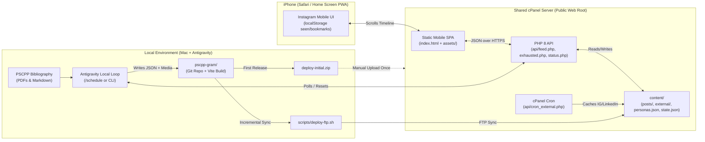

# PSCPP-Gram — Design Specification

**Date:** 2026-11-11  
**Project Folder:** `/Users/ttamer/Documents/PSCPP/pscpp-gram`  
**Target Environment:** Mobile-first web app (iPhone Safari / PWA) hosted on shared cPanel (Apache/LiteSpeed + PHP 8+) with local Antigravity content generation, GitHub version control, initial `.zip` bundle, and incremental FTP deployment.

---

## 1. Purpose & Goals

**PSCPP-Gram** is a public, zero-authentication Instagram-like mobile web application designed to help memorize the Brazilian Navy Pilotage Exam (PSCPP) syllabus through active recall and spaced repetition.

Instead of reading static PDFs, study material from the 7 PSCPP bibliography sections is presented as social media posts (interactive flashcards, multi-slide carousels, annotated infographics, and Reels-style short videos) published by themed fake accounts representing each syllabus section and classic textbook author.

To prevent study fatigue:
1. **External Social Mixer:** Real posts from curated Instagram and LinkedIn accounts are interleaved into the timeline.
2. **Smart Timeline Randomization:** Posts are dynamically shuffled using weighted spaced-repetition rules (prioritizing unseen and bookmarked/hard cards while mixing sections).
3. **Infinite Timeline & Local Creation Loop:** Reaching the end of the timeline immediately reshuffles the deck for uninterrupted scrolling on the iPhone while setting a server state flag (`needs_generation: true`). A local Antigravity loop checks this flag (or runs on schedule), generates new post JSONs from the local PSCPP bibliography, commits them to GitHub, and syncs the `content/posts/` folder to cPanel via FTP.

---

## 2. System Architecture



### Key Architectural Decisions
- **No Server-Side LLM Dependency:** All study content generation happens locally in Antigravity using local files (`/Users/ttamer/Documents/PSCPP/`). The cPanel server only needs standard PHP 8+ to read flat JSON files in `content/posts/` and `content/external/`.
- **Flat-File JSON Content Store:** Each post is a self-contained `.json` file inside `content/posts/` with optional media in `content/posts/media/`. Adding content requires only uploading new `.json` (and media) files via FTP—no database migrations required.
- **Zero Login / Public Access:** Anyone opening the URL gets the full Instagram experience immediately. Personal memorization state (`seen_post_ids`, `bookmarked_post_ids`, `liked_post_ids`, `current_cycle`) lives in the iPhone's `localStorage`, while aggregate cycle exhaustion status lives in `content/state.json` on the server.

---

## 3. Directory Structure (`/Users/ttamer/Documents/PSCPP/pscpp-gram`)

```text
pscpp-gram/
├── docs/
│   └── superpowers/
│       ├── specs/
│       │   └── 2026-11-11-pscpp-gram-design.md
│       └── plans/
├── public/
│   ├── manifest.json                 # iOS PWA manifest (standalone full-screen mode)
│   ├── .htaccess                     # HTTPS redirect, caching, and SPA routing rules for cPanel
│   ├── api/
│   │   ├── config.php                # Shared paths, CORS headers, and optional write token check
│   │   ├── feed.php                  # GET/POST: builds randomized timeline page from content/
│   │   ├── exhausted.php             # POST: marks timeline exhausted & increments cycle in state.json
│   │   ├── status.php                # GET/POST: reports state.json to local Antigravity loop & resets flag
│   │   └── cron_external.php         # CLI/HTTP: cPanel cron script to refresh external IG/LinkedIn cache
│   └── content/
│       ├── personas.json             # Fake Instagram profiles mapped to PSCPP sections & authors
│       ├── external_accounts.json    # List of real Instagram/LinkedIn accounts & RSS/bridge URLs
│       ├── state.json                # Server loop state (needs_generation, completed_cycles, total_posts)
│       ├── external/                 # Normalized JSON posts fetched from real IG/LinkedIn accounts
│       │   └── sample_external_001.json
│       └── posts/                    # Study posts generated from PSCPP source material
│           ├── sample_sec1_crenshaw_001.json
│           └── media/                # Diagrams, SVG infographics, and short MP4/WebM loops
├── src/
│   ├── main.tsx                      # App entry point
│   ├── App.tsx                       # Mobile shell (max-w-[430px], dark theme, safe-area insets)
│   ├── types/
│   │   └── post.ts                   # TypeScript interfaces for Personas, StudyPosts, ExternalPosts
│   ├── hooks/
│   │   ├── useTimeline.ts            # Infinite scroll, weighted shuffle, and exhaustion loop handler
│   │   └── useStudyMemory.ts         # localStorage tracker for seen, liked (mastered), and bookmarked (review)
│   └── components/
│       ├── Header.tsx                # IG top bar with Shuffle button, Section indicator & Loop counter
│       ├── StoriesBar.tsx            # Horizontal ring bar for filtering by Section I–VII or External
│       ├── PostCard/
│       │   ├── PostContainer.tsx     # Fake author header, action bar (Like, Flip, Bookmark), caption, source badge
│       │   ├── FlashcardPost.tsx     # Interactive 3D flip card & multi-slide horizontal swipe carousel
│       │   ├── InfographicPost.tsx   # Zoomable diagram card with toggleable callout pins
│       │   ├── VideoReelPost.tsx     # iOS playsInline muted autoplay short video loop with overlay text
│       │   └── ExternalSocialPost.tsx# Renders real LinkedIn/Instagram posts with "Open Original" link
│       └── BottomNav.tsx             # Feed, Saved/Review Deck (bookmarks only), and Stats/Loop status modal
├── scripts/
│   ├── build-zip.sh                  # Builds Vite app and packages dist/ into deploy-initial.zip
│   ├── deploy-ftp.sh                 # Commits to GitHub and syncs dist/ & content/ to cPanel via FTP
│   └── check-and-loop.sh             # Polls cPanel api/status.php to trigger local content generation
├── .env.example                      # Template for FTP_HOST, FTP_USER, FTP_PASS, FTP_REMOTE_DIR, SITE_URL
├── .gitignore
├── index.html
├── package.json
├── tsconfig.json
└── vite.config.ts
```

---

## 4. Data Contracts & Schemas

### 4.1 Fake Author Personas (`public/content/personas.json`)
Each PSCPP syllabus section and primary book archetype from `IDENTIDADES_VISUAIS_MATERIAIS_PSCPP.md` gets a distinct persona:

```json
[
  {
    "id": "crenshaw.shiphandling",
    "handle": "crenshaw.shiphandling",
    "display_name": "Capt. R. S. Crenshaw Jr.",
    "avatar": "/content/posts/media/avatars/crenshaw.svg",
    "section_id": "sec-1",
    "section_name": "Seção I – Manobrabilidade",
    "bio": "O Prático Militar Clássico • Forces Affecting the Ship",
    "verified": true
  },
  {
    "id": "pna.lewis",
    "handle": "pna.lewis.sname",
    "display_name": "PNA • Lewis (Vol. II & III)",
    "avatar": "/content/posts/media/avatars/pna.svg",
    "section_id": "sec-1",
    "section_name": "Seção I – Manobrabilidade",
    "bio": "Resistência, Propulsão e Controlabilidade (SNAME)",
    "verified": true
  },
  {
    "id": "arte.naval.maia",
    "handle": "maurilio.artenaval",
    "display_name": "Comte. Maurílio Fonseca • Arte Naval",
    "avatar": "/content/posts/media/avatars/artenaval.svg",
    "section_id": "sec-2",
    "section_name": "Seção II – Arte Naval",
    "bio": "A Bíblia da Marinha do Brasil (Vol. I & II)",
    "verified": true
  }
]
```
*(The full seed file includes personas covering all 7 PSCPP sections: Seção I through Seção VII.)*

### 4.2 Study Post Schema (`public/content/posts/<id>.json`)
```json
{
  "id": "2026-11-11-sec1-crenshaw-001",
  "created_at": "2026-11-11T22:00:00Z",
  "batch_cycle": 1,
  "persona_id": "crenshaw.shiphandling",
  "section_id": "sec-1",
  "source": {
    "book": "Crenshaw – Naval Shiphandling (4ª ed.)",
    "chapter": "Cap. 2 – Forces Affecting the Ship",
    "pages": "p. 18",
    "anchor_concept": "Efeito de Pressão Transversal (Paddle-Wheel Effect)"
  },
  "format": "flashcard_carousel",
  "slides": [
    {
      "type": "question",
      "title": "Curva de Evolução & Hélice Monohélice",
      "prompt": "Em um navio monohélice de passo direito dando máquinas adiante partindo do repouso, para qual bordo a popa tende a cair inicialmente e por quê?",
      "media_url": null
    },
    {
      "type": "answer",
      "title": "Popa cai para Boreste (Proa para Bombordo)",
      "body": "Pelo Efeito de Pressão Transversal (Paddle-Wheel Effect): a pá inferior gira em água mais profunda e indisturbada que a pá superior, gerando reação lateral para boreste na popa.",
      "exam_tip": "Cuidado na prova: com seguimento a ré, o efeito transversal soma-se à descarga helicoidal na carena, acentuando fortemente a tendência da popa cair para bombordo."
    }
  ],
  "infographic": null,
  "video": null,
  "caption": "Domine os 4 efeitos do hélice antes de cruzar o canal. Toque no card para virar ou deslize para a resposta da banca.",
  "tags": ["Manobrabilidade", "Crenshaw", "Hélice", "PassoDireito"],
  "difficulty": 2
}
```
Supported `format` values:
- `"flashcard_flip"`: Single card that flips 180° in 3D on tap (Front = Prompt/Diagram, Back = Answer + Exam Tip).
- `"flashcard_carousel"`: Multi-slide swipeable Instagram carousel (up to 5 slides: Hook → Diagram → Concept → Exam Trap).
- `"infographic"`: High-contrast visual schematic/diagram (`infographic.image_url` + interactive `hotspots[]` coordinates that reveal tooltips on tap).
- `"short_video"`: Vertical 9:16 or 4:5 short loop (`video.url`, `video.poster_url`, `video.subtitles[]`).

### 4.3 External Social Post Schema (`public/content/external/<id>.json`)
```json
{
  "id": "ext-linkedin-001",
  "created_at": "2026-11-11T18:00:00Z",
  "is_external": true,
  "platform": "linkedin",
  "author": {
    "handle": "maritime-pilotage-insights",
    "display_name": "Maritime Pilotage & Shiphandling",
    "avatar": "/content/posts/media/avatars/external-default.svg",
    "profile_url": "https://www.linkedin.com"
  },
  "media_type": "image",
  "media_url": "/content/posts/media/sample-external.svg",
  "caption": "Real-world tug escort geometry in restricted channels...",
  "external_url": "https://www.linkedin.com"
}
```

### 4.4 Server Loop State (`public/content/state.json`)
```json
{
  "needs_generation": false,
  "completed_cycles": 0,
  "last_exhausted_at": null,
  "last_generated_at": "2026-11-11T22:00:00Z",
  "total_study_posts": 0
}
```

---

## 5. Timeline Randomization & Loop Logic

### 5.1 Weighted Spaced-Repetition Mixing (`api/feed.php` + `useTimeline.ts`)
When the iPhone requests a page of posts (`POST /api/feed.php`), it sends:
- `seed`: Current random shuffle seed.
- `section_filter`: Optional (`"all"`, `"sec-1"`..`"sec-7"`, `"external"`, or `"bookmarks"`).
- `seen_ids`: Array of post IDs already viewed in the current cycle.
- `bookmarked_ids`: Array of post IDs flagged by the user for extra memorization.

`api/feed.php` constructs a batch of 10 posts using these rules:
1. **Unseen Study Posts (~70%):** Filtered to exclude `seen_ids`. Weighted so consecutive posts come from *different* PSCPP sections whenever possible (preventing section monotony).
2. **Spaced-Repetition Review (~15%):** Drawn from `bookmarked_ids` (high weight) and older `seen_ids` (low weight) so previously seen concepts periodically reappear to lock in long-term memory.
3. **External Real Social Posts (~15%):** Roughly 1–2 posts per 10-post batch drawn from `content/external/*.json` so real-world maritime/LinkedIn/Instagram posts break up intense study blocks.

### 5.2 End-of-Timeline Exhaustion & Local Antigravity Loop
1. **Detection on iPhone:** When `feed.php` returns `unseen_remaining: 0` (meaning every post in `content/posts/` has been seen in the current cycle):
   - The frontend fires `POST /api/exhausted.php`.
   - `exhausted.php` updates `content/state.json` (`needs_generation = true`, `completed_cycles++`, `last_exhausted_at = ISO_TIMESTAMP`).
   - Immediately on the client, `useTimeline.ts` generates a fresh random `seed`, archives the completed cycle count in `localStorage`, resets the current cycle's `seen_ids`, and seamlessly loads the newly reshuffled timeline with a subtle toast: *"Cycle #N complete! Timeline reshuffled & new posts queued."*
2. **Local Generation in Antigravity:**
   - The local script `scripts/check-and-loop.sh` (invoked either on a recurring local schedule via Antigravity's `/schedule` tool or manually) curls `https://<your-domain>/api/status.php`.
   - When `needs_generation === true`, the local agent generates a new batch of study posts from `/Users/ttamer/Documents/PSCPP/` into `public/content/posts/`, runs `scripts/deploy-ftp.sh` (which commits to GitHub and uploads the new files via FTP), and resets `needs_generation = false` via `api/status.php`.

---

## 6. External Social Accounts Integration Plan

To support adding real Instagram and LinkedIn accounts later without changing app code:
- **`public/content/external_accounts.json`** holds the list of target accounts:
  ```json
  {
    "accounts": [
      {
        "id": "sample-linkedin-pilot",
        "platform": "linkedin",
        "handle": "placeholder-account",
        "feed_url": "",
        "enabled": false
      }
    ]
  }
  ```
- **Two Ingestion Paths Ready:**
  1. **cPanel Cron (`public/api/cron_external.php`):** Can be configured in cPanel Cron Jobs (e.g., `0 */6 * * * php /home/user/public_html/api/cron_external.php`) to fetch RSS/JSON feeds (such as RSSHub, RSS.app, Apify, or public oEmbed/JSON endpoints) for each enabled account and write normalized files into `content/external/`.
  2. **Local Antigravity Fetch:** Can also drop scraped/fetched posts into `public/content/external/` locally and push them via `scripts/deploy-ftp.sh`.

---

## 7. Deployment Workflow (GitHub + Initial `.zip` + Incremental FTP)

1. **GitHub Repository:**
   - Initialized in `/Users/ttamer/Documents/PSCPP/pscpp-gram` (or committed as part of the workspace repo) with clean `.gitignore` excluding `node_modules/`, `.env.deploy`, and `deploy-initial.zip`.
2. **First Batch (`.zip` Upload for cPanel File Manager):**
   - Running `npm run build:zip` executes `scripts/build-zip.sh`:
     - Compiles the production Vite bundle into `dist/` (which includes `index.html`, `assets/`, `.htaccess`, `api/*.php`, and `content/`).
     - Produces `/Users/ttamer/Documents/PSCPP/pscpp-gram/deploy-initial.zip` ready to upload and extract directly in cPanel's `public_html` (or subdomain folder).
3. **Incremental Updates (`npm run deploy:ftp`):**
   - Reads credentials from `.env.deploy` (`FTP_HOST`, `FTP_USER`, `FTP_PASS`, `FTP_REMOTE_DIR`).
   - Commits any new/modified files in `public/content/posts/` to Git.
   - Uses `lftp` (or Python/Node FTP fallback built into the script so it works out-of-the-box on macOS) to mirror only changed files to the cPanel server without overwriting server-side `content/state.json`.

---

## 8. Error Handling & Testing Plan

- **Offline / Slow Mobile Network Resilience:** The React frontend caches the current batch of posts in `localStorage` so if iPhone connectivity drops mid-scroll, flipping cards and reviewing bookmarked posts continues to work smoothly.
- **Corrupt JSON Guard in PHP:** `api/feed.php` validates each `.json` file with `json_decode()` and skips malformed files gracefully rather than breaking the feed response.
- **Verification Suite:**
  - Unit tests (`vitest`) for the weighted shuffle/randomization algorithm, spaced-repetition prioritization, and cycle reset logic.
  - PHP local server smoke test (`php -S 127.0.0.1:8080 -t dist`) verifying `api/feed.php`, `api/exhausted.php`, and `api/status.php` end-to-end.
  - Build & packaging verification confirming `deploy-initial.zip` contains all required static, PHP, and seed content files.
